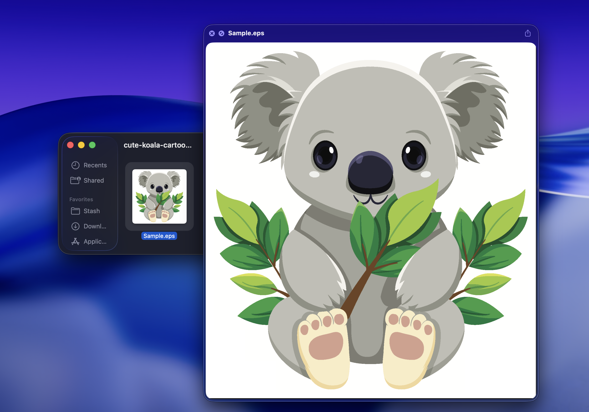

# EPS Quick Look

EPS Quick Look is a macOS app and Quick Look extension for previewing EPS and PostScript files in Finder. It also generates thumbnails for EPS files.

## Install

Download [directly from Codeberg](https://codeberg.org/flew/EPS-Quick-Look/releases).
> [!NOTE]
> Howbrew support will be added soon. 

## Requirements

- macOS 15.6 (Sequoia) or later

## Join Discord

Want to report a bug, suggest a feature, or follow development? Join our Discord server.

[Join the Discord](https://discord.gg/KUY56kppHn)

## Acknowledgements

EPS Quick Look bundles Ghostscript for PostScript parsing/rendering and [Sparkle](https://github.com/sparkle-project/Sparkle) for app updates. The About tab includes an acknowledgements window with both licenses.
